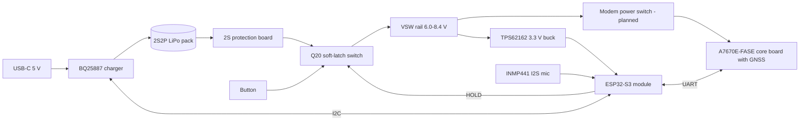

# Rapid Emergency: discreet emergency alert and audio tracking device (hardware)

A charger-shaped device that, when its button is pressed a certain way, powers on, records audio, gets a GPS position
and uploads both over a cellular link to a server. This repository documents the hardware design so far:
what was built, what was chosen, why, what is verified, and what is still to do.

**Status (2026-11-08):** schematic roughly 65 percent drawn in EasyEDA. Done: ESP32 core, soft-latch power switch,
3.3 V buck, 2S charger (power stage and control pins), single status LED, battery connector, battery sense.
Still to draw: USB-C input, microphone connector, modem interface, test pads. No PCB layout yet.

## How to read this repo
Start with `docs/01-requirements.md`, then `docs/02-decision-log.md`. After that read the block docs in number order.
If you are an AI or engineer continuing the work, read `AI_HANDOFF.md` first.

| File | What it holds |
|---|---|
| `AI_HANDOFF.md` | Rules, conventions, current state and the exact next task |
| `docs/01-requirements.md` | What the product must do |
| `docs/02-decision-log.md` | Every design decision, the alternatives, and the reason |
| `docs/03-power-architecture.md` | Rails, current budget, runtime estimates |
| `docs/04-charger.md` | BQ25887 charger design and datasheet findings |
| `docs/05-soft-latch-and-button.md` | Power-on latch and button sensing |
| `docs/06-esp32-and-gpio.md` | ESP32 minimal circuit and pin map |
| `docs/07-status-led.md` | Single LED for button and charging |
| `docs/08-modem-and-battery.md` | Modem board, pack, BMS, connector, sense, planned modem interface |
| `docs/09-firmware-behaviour.md` | State machine, audio, transmission rules |
| `docs/10-pcb-guidelines.md` | Layout guidance for JLCPCB |
| `docs/11-bom.md` | Bill of materials status |
| `docs/12-open-issues-and-risks.md` | Everything unverified or risky |
| `docs/13-roadmap.md` | What to do next, in order |
| `docs/14-mistakes-and-corrections.md` | Errors made along the way and their fixes |
| `docs/15-bench-test-plan.md` | Tests to run on the first prototype |
| `docs/16-references.md` | Datasheets and links actually consulted |
| `docs/17-easyeda-notes.md` | EasyEDA conventions used in this project |
| `hardware/netlists/` | Latest exported netlist (`.tel`) from EasyEDA |
| `hardware/gpio_map.csv` | ESP32 pin assignments |
| `hardware/designators.csv` | Every part drawn so far |
| `hardware/bom/bom_v0.1.csv` | Draft BOM with verification status |
| `tools/check_netlist.py` | Script that checks a netlist against the expected connections |

## Confidence tags used throughout
- `[DATASHEET]` read in a manufacturer datasheet during this project
- `[LISTING]` taken from a seller or distributor listing
- `[MEMORY]` recalled from general knowledge, not checked: verify before relying on it
- `[ESTIMATE]` calculated or guessed, to be replaced by measurement
- `[DECISION]` a choice made by the project owner or agreed in discussion

## System overview

## Important notes
- Several choices rest on unverified assumptions (cell capacity, modem board input range). See `docs/12-open-issues-and-risks.md`.
- Product-use and consent risks for a covert recording device were raised early and set aside by the project owner.
  They are listed in the open issues and should be revisited before any release.
