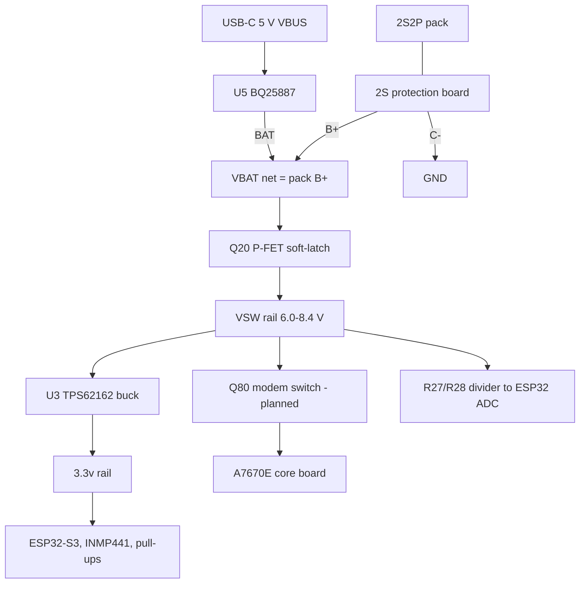

# 03. Power architecture

## Rails
| Net | Voltage | Source | Feeds |
|---|---|---|---|
| VBAT | 6.0-8.4 V | Pack through BMS (B+) | Q20 source, charger BAT, battery connector |
| VSW | 6.0-8.4 V | Q20 when on | Buck input, modem switch (planned), sense divider |
| 3.3v | 3.3 V | U3 buck | ESP32, INMP441, pull-ups, LED supply diode D31 |
| REGN | 4.7-4.8 V, 50 mA max `[DATASHEET]` | Charger, only with USB present | TS divider, LED supply diode D30 |
| VBUS | 5 V | USB-C | Charger input |
| GND | 0 V | BMS C- | Everything |

The BMS has one shared port: charger and load both connect to B+ and C-. The cell midpoint (B1) goes to the charger MID pin.

## Standby
With the device off, no part draws meaningful current except the charger's own battery leakage:
**12 uA typical, 14 uA max at 25 C, 20 uA max** `[DATASHEET]`. That is about 9-14 mAh per month. This holds only if the I2C pull-ups
sit on the switched 3.3 V rail (they do).

## Peak currents `[ESTIMATE]`
- Modem peak 2 A at its own rail (about 3.8 V) for under a millisecond (2G burst). From the pack: **about 1.2-1.5 A**.
- Plan: bulk capacitor 2000 uF (16 V or higher) at the modem VIN, behind its switch, with soft-start on the switch.
- If the cells really are 700 mAh and rated 1C, the pack can give about 1.4 A. If they are about 200 mAh each, it cannot.

## Power budget `[ESTIMATE]` (replace with measurements)
| Mode | From the pack |
|---|---|
| Phase B (ESP32 + modem + GNSS active) | 1.4-2.4 W |
| Phase B total, first 30 min | 0.7-1.2 Wh |
| Phase C, quiet (5-minute check-ins) | 0.2-0.45 W |
| Phase C, busy audio | about 1 W |

| Pack assumption | Usable energy (to 3.3 V per cell) | Phase C quiet | Phase C busy |
|---|---|---|---|
| Genuine 700 mAh cells | about 8.8 Wh | 17-40 h | about 8 h |
| About 200 mAh per cell | about 2.5 Wh | 3-9 h | 1.5-2 h |

The owner expects 2-4 hours, which matches the small-cell or busy-audio case.

## Charging maths
Charger efficiency about 93 percent `[DATASHEET]`. Input current from 5 V:
| Pack charge current | Input power | Input current |
|---|---|---|
| 0.5 A | about 4.1 W | about 0.82 A |
| 1 A | about 8.2 W | about 1.6 A (many cheap chargers cannot supply this) |
Prototype 1 uses ILIM 1.87 kohm: about 0.59 A input, about 0.37 A into the pack at 7.4 V.

## Protections
- BMS: cheap 2S board (marking "YX-514"?), thresholds unknown. Replace with a datasheet-backed protection IC for production.
- Firmware: last-gasp 3.3 V per cell, stop at 3.0 V per cell.
- Charger: 12 h safety timer, JEITA via TS, input limited by ILIM.
- Planned on USB: TVS and ESD diodes.
