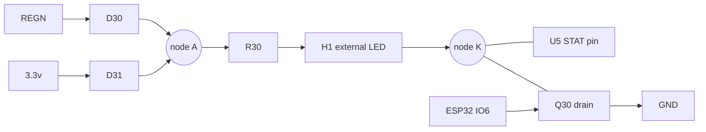

# 07. Status LED (one LED, two jobs)

One external LED on two wires (header H1) shows **button press** (brief blink) and **charging** (solid).

## Why one ESP32 pin is not enough
The ESP32 is off while the device charges, so no ESP32 pin can show charging. The charger's STAT pin must light the LED by itself.
STAT is open-drain: it can only pull down, never source current. So the LED needs a supply that exists while charging (REGN) and
one that exists on battery (3.3 V), and a sink for each (STAT and an ESP32-driven transistor).

## Circuit
| Ref | Value | Connection |
|---|---|---|
| D30 | BAT54WS | Anode REGN, cathode node A |
| D31 | BAT54WS | Anode 3.3v, cathode node A |
| R30 | 1 k | Node A to H1 pin 1 (LED anode) |
| H1 | 2-pin 2.00 mm header | Pin 1 anode, pin 2 cathode (node K = STAT net) |
| Q30 | 2N7002 | Drain node K (STAT net), source GND, gate LED net (IO6) |
| R31 | 100 k | LED net to GND (gate pull-down) |
| U5 pin 2 | STAT | Joins node K |

## Behaviour
| Situation | LED |
|---|---|
| Charging, device off | Solid on (STAT pulls K low) |
| Charging, button pressed | **Stays solid; blink not visible** (accepted, D21 in decision log) |
| Charge complete, button pressed | Blinks (REGN supply, Q30 sinks) |
| Charger fault | Blinks about 1 Hz (charger) |
| No charger, button pressed | Blinks (3.3 V supply, Q30 sinks) |

Current: about 2.4 mA from REGN, about 1 mA from 3.3 V `[ESTIMATE]`.
**Open:** with the LED off, node K floats toward node A (about 4.4 V); confirm the STAT pin's maximum rating.
Optional later: pause charging over I2C for a moment to make a dip (charge-enable bit not yet checked in the register map).

## Mounting
3 mm LED in a drilled hole with glue or a bezel, or a 0603 LED on a scrap board behind a 1-1.5 mm hole, or a plastic fibre light pipe.
Wire: 28-30 AWG twisted pair, up to about 10 cm. Reversed polarity just does not light.
