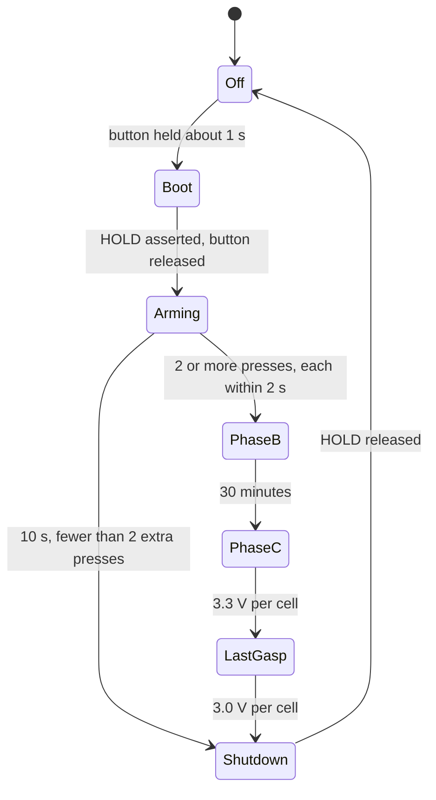

# 09. Firmware behaviour (design intent, nothing written yet)

## Rules
- **Hold early:** drive HOLD (IO4) high in a bootloader hook. The user holds the first press about 1 s.
- **Phase B (30 min):** start the modem and GNSS and begin recording at once; do not wait for a fix. 20 s ADPCM segments (8 kHz, about 4 KB/s, about 80 KB each). Upload each as it completes
  with GPS, battery and device ID. Recording and upload run concurrently with buffering in PSRAM.
- **Phase C:** ESP32 awake, mic on, silence discarded. Transmit on: 5 minutes since last send, 20 s of meaningful audio, GPS moved over threshold (start 50 m with speed and fix-quality filtering).
  Modem off (or lowest sleep) between sends. Report battery and status.
- **No coverage:** retry alert and location indefinitely. Keep recording but retain only the **first 1 MB**.
- **Low battery:** last-gasp at 3.3 V per cell (alert and GPS only, long sleeps), stop at 3.0 V per cell, then release HOLD. Read VBAT through the IO2 divider (charger ADC also possible).
- **Silence gate:** amplitude threshold with hangover, adjustable at test time; consider VAD later.
- **Transport:** HTTPS POST, binary body, JSON metadata in headers (device ID, sequence, GPS, battery). One POST per batch (TLS handshake on 2G costs seconds). Upload the CA certificate to the modem and watch certificate expiry.
- **Audio rate:** capture at 16 kHz and decimate to 8 kHz in firmware `[MEMORY]` (INMP441 minimum sampling rate to be checked).
- **Charger control:** default mode charges autonomously. Over I2C the ESP32 can read cell voltages and status and, if needed, change charge current.
- **Security:** disable JTAG and USB debug with eFuses for production.

## Known weakness
If the ESP32 resets, HOLD drops and the device powers off (see `05-soft-latch-and-button.md`). A watchdog strategy is needed.
